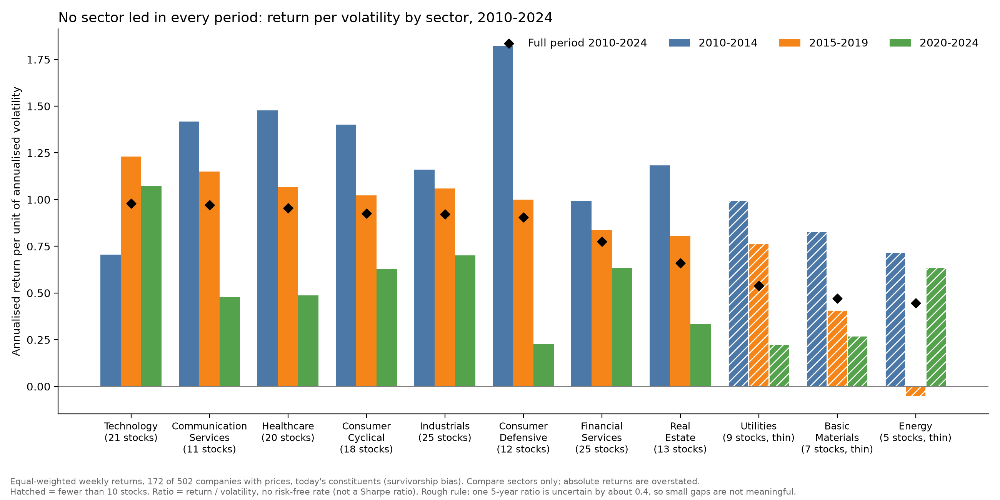
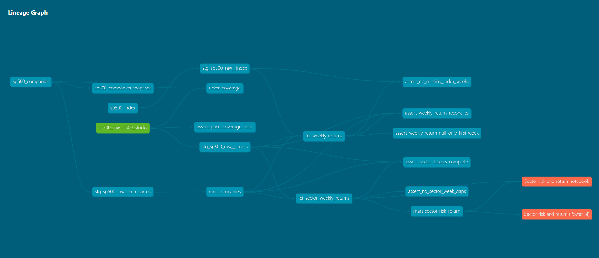

# dbt S&P 500 Financial Pipeline

A dbt project that transforms raw S&P 500 stock and company data into analytics-ready models on Databricks. It shows dimensional modelling, an incremental model, an SCD Type 2 snapshot, custom Jinja macros, data quality testing and GitHub Actions CI, and it ends in a sector-level risk and return analysis for 2010–2024.

**Analysis question:** which sectors gave the best return for the volatility taken between 2010 and 2024, and did that hold in each 5-year sub-period?

**Short answer:** the data cannot rank the leading sectors. The top six are a near tie once noise is measured. The only change over time bigger than the noise is Consumer Defensive's drop after 2014, and only just.

**Read first:** the source has prices for only 172 of the 502 companies. The [Data Investigation](#data-investigation-why-are-330-companies-missing) section explains why, and why the results are still usable for comparing sectors.

---

## Contents

- [Results](#results)
- [Lineage](#lineage)
- [Models](#models)
- [Data Quality Testing](#data-quality-testing)
- [Continuous Integration](#continuous-integration)
- [Data Investigation: why are 330 companies missing?](#data-investigation-why-are-330-companies-missing)
- [Bugs Found and Fixed](#bugs-found-and-fixed)
- [Decision Log](#decision-log)
- [How to Run](#how-to-run)
- [Known Limitations](#known-limitations)
- [Open Questions](#open-questions)
- [Interview Questions](#interview-questions)
- [Data Source](#data-source)

---

## Results

Sector risk and return, equal-weighted, 2010–2024, for the 172 stocks with price data. Full analysis: [`notebooks/sector_risk_return.ipynb`](notebooks/sector_risk_return.ipynb).



| Sector | Stocks with prices | Annualised return | Annualised volatility | Return per volatility | 95% range |
|---|---|---|---|---|---|
| Technology | 23 | 22.3% | 22.8% | 0.98 | 0.47 to 1.68 |
| Communication Services | 12 | 18.7% | 19.2% | 0.97 | 0.41 to 1.65 |
| Healthcare | 21 | 17.4% | 18.2% | 0.95 | 0.45 to 1.62 |
| Consumer Cyclical | 18 | 20.5% | 22.2% | 0.93 | 0.37 to 1.66 |
| Industrials | 27 | 19.4% | 21.1% | 0.92 | 0.38 to 1.63 |
| Consumer Defensive | 12 | 12.4% | 13.7% | 0.91 | 0.41 to 1.48 |
| Financial Services | 25 | 16.3% | 21.0% | 0.77 | 0.26 to 1.48 |
| Real Estate | 13 | 13.9% | 21.0% | 0.66 | 0.22 to 1.31 |
| Utilities | 9 | 10.0% | 18.5% | 0.54 | 0.13 to 1.17 |
| Basic Materials | 7 | 12.1% | 25.7% | 0.47 | 0.02 to 1.08 |
| Energy | 5 | 12.4% | 27.7% | 0.45 | −0.05 to 1.06 |

**Findings**
- **The full-period ranking is noise.** A 15-year ratio is uncertain by about ±0.3 (block bootstrap). The top six sit between 0.91 and 0.98, with overlapping 95% ranges of roughly 0.4 to 1.7.
- **Only one change over time beats the noise.** Consumer Defensive fell from 1.82 (2010–14) to 0.23 (2020–24). The 95% range of that change is −2.82 to −0.36, so it excludes zero.
- **That result is borderline.** It fails a stricter check that allows for testing 11 sectors (99.5% range −3.27 to +0.08), and the comparison was chosen after looking at the chart. Treat it as a strong lead, not proof. It holds at every bootstrap block length tested (1 to 26 weeks).
- **Big-looking moves elsewhere are within noise.** Healthcare (−0.99) and Communication Services (−0.94) both have ranges that include zero. Technology's jump from 11th to 1st is a +0.37 change. Ranks make small differences look large.
- **Thin sectors.** Energy, Basic Materials and Utilities rest on 5, 7 and 9 stocks, so one company can move them.

**Outputs:** the notebook (done), a two-page Power BI companion file in `dashboard/` (built from `mart_sector_risk_return`), and a one-page memo (to do).

---

## Lineage



> The screenshot predates the Nov 2026 changes. The seeds are now read with `ref()`, so they appear as parents of the staging models. Regenerate with `dbt docs generate` and `dbt docs serve`.

**Seeds and source → Staging → Marts → Exposures**

- 2 seeds: `sp500_companies`, `sp500_index`
- 1 source: `sp500_raw.sp500_stocks` (94 MB, loaded into Databricks outside dbt)
- 3 staging models: `stg_sp500_raw__companies`, `stg_sp500_raw__stocks`, `stg_sp500_raw__index`
- 1 snapshot: `sp500_companies_snapshot`
- 4 mart models: `dim_companies`, `fct_weekly_returns`, `fct_sector_weekly_returns`, `mart_sector_risk_return`
- 6 singular tests (see [Data Quality Testing](#data-quality-testing))
- 1 analysis: `analyses/ticker_coverage.sql` (per-ticker price coverage)
- 2 exposures: `sector_risk_return_dashboard` (Power BI), `sector_risk_return_notebook`

---

## Tech Stack

| Tool | Purpose |
|---|---|
| dbt Core 1.11 | Transformations, testing, documentation |
| dbt-databricks 1.12 | Compute and Delta Lake storage (Databricks Free Edition, serverless SQL warehouse) |
| dbt_utils | Surrogate keys, range and uniqueness tests |
| pandas, matplotlib, scipy | Notebook: independent recompute, coverage checks, bootstrap, chart |
| Power BI Desktop | Companion view of the sector mart |
| GitHub Actions | CI on every pull request |

---

## Project Structure

```
dbt_sp500_stocks/
├── .github/workflows/ci.yml       # CI: notebook job + dbt build on Databricks
├── ci/profiles.yml                # CI-only dbt profile (env vars, no secrets)
├── analyses/ticker_coverage.sql   # Per-ticker price coverage
├── dashboard/sector_risk_return.pbix
├── data/                          # CSV snapshots the notebook reads
├── macros/
│   ├── drop_ci_schemas.sql        # Drops CI schemas after a run (guarded)
│   ├── generate_schema_name.sql   # Schema per environment and layer
│   ├── marketcap_bucket.sql
│   ├── rolling_avg.sql
│   └── volatility.sql
├── models/
│   ├── staging/                   # 3 views + _sources.yml
│   └── marts/                     # 4 tables + exposures.yml
├── notebooks/sector_risk_return.ipynb
├── seeds/                         # sp500_companies.csv, sp500_index.csv
├── snapshots/sp500_companies_snapshot.sql
├── tests/                         # 6 singular tests
├── requirements.txt               # dbt
└── requirements-notebook.txt      # notebook
```

---

## Models

### `fct_weekly_returns` (incremental)
One row per stock per week, **2010 onwards** (128,070 rows: 172 stocks, 781 weeks).
- `weekly_return` = this week's last **adjusted** close ÷ last week's last adjusted close − 1, in percent. It is null in each stock's first week.
- Index columns (`avg_index_value` and the others) are **null before 2014-12-22**, because the index source starts then. The index is joined with a left join so that stock weeks before 2014 are kept.
- `week_opening_price`, `week_lowest_price` and `week_highest_price` are **unadjusted**. `week_closing_price` and `avg_stock_price` are adjusted. Do not compute a return from the open and the close.
- Also carries a 4-week rolling average price and a 12-week rolling volatility (via macros).
- **Incremental logic:** the watermark is `stock_week_start_date`. Each run re-reads the last 14 weeks so that the return, the 4-week average and the 12-week volatility of new weeks see a full window, then keeps only the weeks after the watermark (merge on `weekly_return_key`).
- Nothing downstream reads this model today: the dashboard and the notebook use the sector models.

### Sector models
Built from `stg_sp500_raw__stocks` and `dim_companies`.

`fct_sector_weekly_returns` (one row per sector per week, 2010-01-11 to 2024-12-16)
- Weekly close = adjusted close on the last trading day of the week.
- Stock weekly return = this week's close ÷ previous week's close − 1 (a fraction, not a percent).
- Sector weekly return = simple average across the sector's stocks that week (equal-weighted). `ticker_count` shows how many stocks sit behind each number.

`mart_sector_risk_return` (one row per sector per period: 2010–2014, 2015–2019, 2020–2024, full)
- Annualised return = exp(avg(ln(1 + r)) × 52) − 1
- Annualised volatility = sample standard deviation of ln(1 + r) × √52
- Return per volatility = annualised return ÷ annualised volatility. There is no risk-free rate, so it is not a Sharpe ratio.

### `dim_companies`
One row per company (502), with a surrogate key and a market-cap bucket from the `marketcap_bucket` macro. All attributes are **as of the download date** (Dec 2024), not historical.

### SCD Type 2 snapshot: `sp500_companies_snapshot`
Tracks changes to company name, sector, industry and location with dbt's check strategy. Uses `dbt_valid_to_current = 9999-12-31` and `hard_deletes = new_record`. It writes to the base schema (`sp500_dev`). There is one version per company (502 rows), because the seed has not changed since the first run.

### Macros
- **`marketcap_bucket(market_cap)`**: fixed thresholds: under $20B `large_cap`, $20B–75B `big_cap`, $75B–200B `mega_cap`, over $200B `super_mega_cap`.
- **`rolling_avg(column, partition_by, order_by, window_size)`**: rolling average with a window function.
- **`calc_volatility(price_col, ticker_col, date_col, window_rows)`**: rolling standard deviation of weekly log returns × √52 (a fraction, so 0.25 = 25%).
- **`generate_schema_name`**: builds `<target schema>_<layer>`, for example `sp500_dev_marts` or `sp500_ci_marts`.
- **`drop_ci_schemas`**: drops the CI schemas after a CI run. It refuses to run unless the target is `ci` and the schema starts with `sp500_ci`.

---

## Data Quality Testing

78 data tests: generic tests (`not_null`, `unique`, `accepted_values`, `relationships`, `dbt_utils.accepted_range`, `dbt_utils.unique_combination_of_columns`) and 6 singular tests.

| Singular test | Fails when |
|---|---|
| `assert_price_coverage_floor` | Fewer than 172 tickers have prices in the raw table, for example after reloading a worse file |
| `assert_weekly_return_reconciles` | `fct_weekly_returns.weekly_return` differs by more than 1e-6 from an independent calculation that chains daily returns |
| `assert_weekly_return_null_only_first_week` | `weekly_return` is null in any week other than a stock's first |
| `assert_no_missing_index_weeks` | A stock week inside the index's date range has no index row |
| `assert_no_sector_week_gaps` | A sector skips a week, which would turn a two-week move into a "weekly" return |
| `assert_sector_tickers_complete` | The sector model never reaches the full number of stocks (loss) or goes above it (duplication) |

**Other checks**
- The notebook recomputes the sector mart in pandas and stops if any value differs by more than 1e-9.
- Hand check: Energy, week of 2020-03-09, recomputed from raw prices for all 5 stocks (−2.43%), matched the sector model.
- Before the Nov 2026 changes, `dbt build` passed with PASS=81, WARN=0, ERROR=0. **TODO:** update after the next full build.

---

## Continuous Integration

`.github/workflows/ci.yml` runs on every pull request into `main` and on demand. It has two jobs.

**1. Notebook (no secrets).** Installs `requirements-notebook.txt` and runs the notebook on the committed CSV snapshots. The notebook stops on any failed check (row counts, the pandas vs mart reconciliation), so a clean run is a real test.

**2. dbt on Databricks.**
1. Installs dbt from `requirements.txt` and checks that the three secrets are set.
2. Runs `dbt deps`, then `dbt debug` (connection), then `dbt build`, which runs seeds, models, the snapshot and all tests.
3. Runs `fct_weekly_returns` again and re-tests it, to exercise the incremental path.
4. Always drops the CI schemas at the end, pass or fail.

**How it stays away from dev data**
- CI uses its own profile (`ci/profiles.yml`) with target `ci` and schema `sp500_ci`. Everything it builds goes into `sp500_ci`, `sp500_ci_raw`, `sp500_ci_stg` and `sp500_ci_marts`.
- One exception: the 94 MB `sp500_stocks` table only exists in `sp500_dev_raw`, so CI reads it there (read only) through the `raw_schema` variable. CI never writes to a dev schema.
- The cleanup macro refuses to drop any schema that does not start with `sp500_ci`.
- Runs are queued one at a time (`concurrency`), because they share the `sp500_ci` schemas.

**Setup (once)**
1. In Databricks, create a personal access token for CI only (User settings > Developer > Access tokens), with a 90-day lifetime.
2. In GitHub: Settings > Secrets and variables > Actions > New repository secret. Add `DATABRICKS_HOST` (without `https://`), `DATABRICKS_HTTP_PATH` and `DATABRICKS_TOKEN`.
3. After the first green run: Settings > Branches > add a rule for `main` that requires both CI jobs to pass before merging.

---

## Data Investigation: why are 330 companies missing?

**What we see.** The raw table has 1,891,536 rows, which is exactly 502 tickers × 3,768 trading days. But 330 tickers have no prices on any day: every price column is null. Staging drops null rows, which leaves 617,831 rows for 172 tickers.

**Was it our load into Databricks?** No. A fresh download from Kaggle (Nov 2026) has the same 330 empty tickers, the same row counts and the same dates. The Kaggle dataset was last updated in Dec 2024, so there is no fixed version to switch to.

**Are the missing companies a pattern (big ones, one sector, one part of the alphabet)?** No.

| Size rank (by index weight) | Have prices |
|---|---|
| 1–100 | 35 of 100 |
| 101–200 | 33 of 100 |
| 201–300 | 34 of 100 |
| 301–400 | 39 of 100 |
| 401–502 | 31 of 102 |

- Chi-square tests find no pattern by size band (p = 0.78) or by sector (p = 0.52).
- In the file's own order, the empty tickers are scattered in 223 separate runs, not one block.
- Missing big names include Apple, Alphabet class A, Broadcom, Berkshire Hathaway, Walmart, Eli Lilly, JPMorgan, Mastercard, ExxonMobil, UnitedHealth, Costco and Procter & Gamble. NVIDIA, Microsoft, Amazon, Meta, Tesla, Visa and Oracle have prices.
- The 172 stocks with prices hold 45% of the index by weight (34% by count), because a few giants happen to be included.

**What is the most likely cause?** The dataset is built from Yahoo Finance. Whole tickers coming back empty, scattered at random, is what a bulk download looks like when some requests fail or are rate-limited. This cannot be proven from the file alone (see [Open Questions](#open-questions)).

**What about tickers with only part of the history?** 22 tickers start after 2010-01-04 because they listed later, for example TSLA (2010), META (2012), UBER (2019), VLTO (2023) and SOLV (2024). That is normal, not a data error.

**What does it mean for the results?** The 172 behave like a random third of the index. Sector comparisons are thin but not biased by company size or sector. Every result describes "these 172 stocks", not "the S&P 500".

**How do we stop it getting worse?** `assert_price_coverage_floor` fails if a reload has fewer than 172 priced tickers. `analyses/ticker_coverage.sql` lists coverage per ticker.

---

## Bugs Found and Fixed

Found in Nov 2026, while checking the data. All of them passed every test that existed before.

1. **`fct_weekly_returns.weekly_return` was wrong.** It divided an adjusted close (lowered for dividends and splits paid later) by an unadjusted open. Example, week of 2015-01-05: Chevron showed −35.7% when it actually fell 2.5%. About 12,000 of 87,797 weeks showed moves over ±20%, against about 330 really. The range test (−100% to +1,000%) let it through. **Fix:** close to close on adjusted prices, plus `assert_weekly_return_reconciles`, which recomputes the return a different way. Nothing downstream used the column, so no published number changed.
2. **`assert_no_missing_index_weeks` could never fail.** It inner-joined the index and then looked for rows with no index, which an inner join cannot return. **Fix:** rewritten to check every stock week inside the index's date range.
3. **`fct_weekly_returns` silently dropped 2010–2014.** The inner join to the index removed every week before the index starts (2014-12-22). **Fix:** left join; index columns are null before 2014-12-22.
4. **Seeds were read with `source()` instead of `ref()`.** dbt did not know the staging models depend on the seeds. It worked in dev only because the seed tables already existed, and it would fail in a fresh schema such as CI. **Fix:** `ref('sp500_companies')` and `ref('sp500_index')`.
5. **The dbt exposure pointed to a Looker Studio URL** for a dashboard that does not exist. **Fix:** exposures now describe the Power BI file and the notebook, with their real parent models.
6. **Rolling columns were wrong at the start of each incremental batch.** **Fix:** the 14-week lookback (see [Models](#models)).

---

## Decision Log

| Date | Decision | Why | Rejected alternative |
|---|---|---|---|
| May 2026 | Use the Kaggle dataset, not a Yahoo Finance script | The project's goal was dbt skills (snapshot, macros, incremental), not ingestion | Pull prices with `yfinance` (planned later as an extension) |
| May 2026 | Load `sp500_stocks` through the Databricks UI, not as a seed | The file is about 94 MB, too large for `dbt seed` and for GitHub | Commit the CSV |
| Nov 2026 | Build the sector models from staging, not from `fct_weekly_returns` | That model started in Dec 2014 and its return was open to close | Reuse `fct_weekly_returns` |
| Nov 2026 | Keep the 172 stocks and document the gap | The gaps are random (no size or sector pattern), and re-pulling 502 tickers would change every number and test | Re-pull all 502 tickers from Yahoo now |
| Nov 2026 | Report uncertainty with a block bootstrap (8-week blocks, 2,000 resamples) | Fewer assumptions than the textbook formula; the formula is shown too | Formula only |
| Nov 2026 | Headline only what beats the noise | Ranks and small gaps between sectors are within noise | "No sector led in every period" |
| Nov 2026 | `fct_weekly_returns`: left join the index, start in 2010 | Nothing is calculated from the index, so the inner join threw away five years for no benefit | Keep the inner join |
| Nov 2026 | `weekly_return` close to close on adjusted prices | Standard measure, matches the sector models, includes dividends | Raw close ÷ raw open (consistent, but ignores overnight moves and dividends) |
| Nov 2026 | CI reads `sp500_stocks` from `sp500_dev_raw` (read only) | The table is too big to reload per CI run; everything else is built in `sp500_ci*` schemas | Copy the raw table into a CI schema each run |
| Nov 2026 | Correct the Kaggle link to Larxel's dataset | The files match it (16-column companies file with `Weight`); the old link was a different dataset | — |

---

## How to Run

### Prerequisites
- Python 3.12 (3.15 failed to build the dependencies)
- A Databricks workspace and SQL warehouse, and a personal access token

### Setup (Windows PowerShell)

```powershell
git clone https://github.com/nmacharla889/dbt_sp500_stocks.git
cd dbt_sp500_stocks

py -3.12 -m venv dbt-env
.\dbt-env\Scripts\Activate.ps1
python -m pip install --upgrade pip
pip install -r requirements.txt
pip install -r requirements-notebook.txt   # only for the notebook

$env:DATABRICKS_TOKEN = "your-token"
dbt deps --profiles-dir .
```

Create `profiles.yml` in the repository root. It is gitignored. Keep the token out of it and read it from the environment:

```yaml
sp500stocks:
  target: dev
  outputs:
    dev:
      type: databricks
      catalog: stocks
      schema: sp500_dev
      host: <workspace hostname, without https://>
      http_path: <SQL warehouse HTTP path>
      token: "{{ env_var('DATABRICKS_TOKEN') }}"
      threads: 4
```

### Load the stock prices (once)
1. Download `sp500_stocks.csv` from the Kaggle dataset under [Data Source](#data-source).
2. In Databricks, upload it as table `stocks.sp500_dev_raw.sp500_stocks`, with columns `date`, `symbol`, `adj_close`, `close`, `high`, `low`, `open`, `volume`.
3. Expect 1,891,536 rows, 502 symbols, 2010-01-04 to 2024-12-20.

### Run

```powershell
dbt build --profiles-dir .            # seeds, models, snapshot, tests
dbt docs generate --profiles-dir .
dbt docs serve --profiles-dir .
```

### Incremental vs full refresh

```powershell
# Incremental (default): processes weeks after the latest one in the table
dbt run --select fct_weekly_returns --profiles-dir .

# Full refresh: rebuilds from scratch. Needed once after the Nov 2026 change to fct_weekly_returns.
dbt build --select fct_weekly_returns --full-refresh --profiles-dir .
```

### Schemas

| Layer | Dev | CI |
|---|---|---|
| Raw (seeds; `sp500_stocks` in dev only) | `sp500_dev_raw` | `sp500_ci_raw` (seeds only) |
| Staging | `sp500_dev_stg` | `sp500_ci_stg` |
| Marts | `sp500_dev_marts` | `sp500_ci_marts` |
| Snapshot | `sp500_dev` | `sp500_ci` |

---

## Known Limitations

- **Only 172 of 502 companies have prices** (45% of index weight). See [Data Investigation](#data-investigation-why-are-330-companies-missing).
- **Survivorship bias.** Constituents are today's, so companies that left the index are missing and absolute returns are overstated. Compare sectors only.
- **Sector labels are today's.** Sectors come from the Dec 2024 company file and are applied back to 2010. For example, Communication Services only became a GICS sector in 2018, so "Communication Services in 2010–14" groups companies by their current label, not the one they had then.
- **Market-cap buckets are today's.** `market_cap_bucket` in `fct_weekly_returns` uses Dec 2024 market caps for every week since 2010.
- **Index data starts on 2014-12-22.** Index columns in `fct_weekly_returns` are null before then.
- **Mixed price bases in `fct_weekly_returns`.** Open, high and low are unadjusted; close and average are adjusted. Use `weekly_return`, never open vs close.
- **Mixed units.** `fct_weekly_returns.weekly_return` is a percent; sector returns and volatilities are fractions.
- **Thin sectors.** Energy (5 stocks), Basic Materials (7) and Utilities (9).
- **Changing membership.** Late-listed stocks (TSLA, META, UBER and others) enter sector averages from their second week, so `ticker_count` changes over time.
- **Equal weighting.** It does not match the cap-weighted S&P 500.
- **No risk-free rate.** Return per volatility is not a Sharpe ratio.
- **Snapshot has no history.** The seed has never changed, so the SCD Type 2 logic has not yet recorded a real change.

---

## Open Questions

Things the project has not answered yet.

1. **Is the cause of the missing tickers really failed downloads?** Consistent with the evidence, but not proven. Proving it would need Kaggle's download logs, or a fresh pull showing those tickers have data on Yahoo.
2. **Would the results change with all 502 companies?** Unknown until the prices are re-pulled (the planned `yfinance` extension).
3. **Does equal weighting drive the findings?** A cap-weighted version has not been built.
4. **Does adding a risk-free rate change the ranking?** Not tested. Subtracting the same rate from every sector changes ratios by different amounts, because each divides by a different volatility.
5. **Are the results sensitive to the period boundaries?** Only calendar 5-year blocks were tested. Rolling 5-year windows would show whether the Consumer Defensive drop depends on where the cut falls.
6. **How large is the survivorship bias?** Not measured. It would need historical index membership.
7. **Market-cap bucket naming.** `large_cap` is the smallest bucket (under $20B), which reads oddly next to the usual meaning of "large cap". Rename to `under_20b` and so on? That would change accepted values and any dashboard filter.
8. **Column name typo.** `ebidta_earnings` should be `ebitda_earnings`. Renaming touches the staging model, `dim_companies` and their YAML.

---

## Interview Questions

**Questions this project can answer**

| Question | Short answer |
|---|---|
| Why do 330 companies have no prices? | Missing in the source file, not our load; scattered evenly, most likely failed downloads. See Data Investigation. |
| Doesn't that bias the results? | Not by size or sector (chi-square p = 0.78 and 0.52). It makes them thin, and they describe 172 stocks, not the S&P 500. |
| How do you know your numbers are right? | dbt tests, an independent pandas recompute that must match the mart to 1e-9, a reconciliation test on weekly returns, and a hand check. |
| Tell me about a bug you found | The weekly return mixed adjusted and unadjusted prices. Every test passed, because a range test cannot see a wrong formula. Fixed it and added a reconciliation test. |
| Why didn't your tests catch it? | Range tests check plausibility, not correctness. A −36% weekly move is plausible. Only an independent calculation catches a wrong formula. |
| How uncertain is each ratio? | About ±0.3 over 15 years and ±0.4 to 0.6 over 5 years (block bootstrap; the formula gives 0.45 to 0.73). |
| Why a block bootstrap? | Weekly returns are not fully independent, and the formula assumes they are. Blocks keep runs of related weeks together. The Consumer Defensive result holds at every block length from 1 to 26 weeks. |
| Why close to close and not open to close? | It captures overnight moves and, on adjusted prices, dividends. It is the standard measure and matches the sector models. |
| Why an incremental model on static data? | To show the pattern. CI runs it twice to exercise the incremental path. The 14-week lookback keeps rolling windows correct. |
| How do you keep CI away from dev data? | Separate profile and schemas, a read-only exception for one raw table, and a cleanup macro that refuses to drop anything outside `sp500_ci*`. |
| Why are seeds read with `ref()`? | So dbt knows the dependency. With `source()`, a fresh schema (CI) would run staging before the seeds exist. |

**Questions this project cannot answer yet** (see [Open Questions](#open-questions))
- What do the results look like for all 502 companies, or cap-weighted, or with a risk-free rate?
- How much do survivorship bias and today's sector labels distort the 2010–14 numbers?
- Can you prove the missing tickers came from failed downloads?
- Has your SCD Type 2 snapshot ever captured a real change? (Not yet: the seed has not changed.)

---

## Data Source

[Kaggle: S&P 500 Stocks (daily updated), by Larxel](https://www.kaggle.com/datasets/andrewmvd/sp-500-stocks). Last updated Dec 2024. Three files: daily prices for 502 current constituents (2010–2024), company metadata as of Dec 2024, and the S&P 500 index series (from 2014-12-22).
