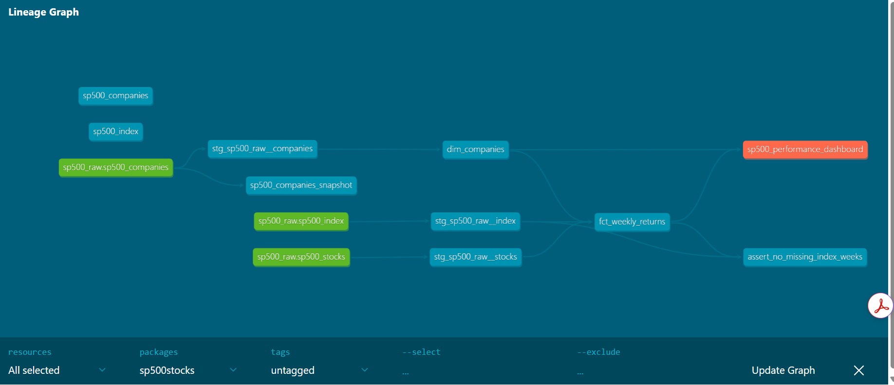

# dbt S&P 500 Financial Pipeline

A dbt project that transforms raw S&P 500 stock and company data into analytics-ready models on Databricks. It demonstrates dimensional modelling, incremental loading, SCD Type 2 snapshots, custom Jinja macros and data quality testing, and it ends in a sector-level risk and return analysis for 2010–2024.

Analysis question: which sectors gave the best return for the volatility taken between 2010 and 2024, and did that hold in each sub-period?

---

## Lineage Graph



**Sources → Staging → Marts → Exposure**

- 3 raw sources: `sp500_companies`, `sp500_stocks`, `sp500_index`
- 3 staging models: `stg_sp500_raw__companies`, `stg_sp500_raw__stocks`, `stg_sp500_raw__index`
- 1 snapshot: `sp500_companies_snapshot`
- 4 mart models: `dim_companies`, `fct_weekly_returns`, `fct_sector_weekly_returns`, `mart_sector_risk_return`
- 3 singular test: `assert_no_missing_index_weeks`, `assert_no_sector_week_gaps`, `assert_sector_tickers_complete`
- 1 exposure: `sp500_performance_dashboard`

---

## Tech Stack

| Tool | Purpose |
|---|---|
| dbt Core 1.11 | Transformations, testing, documentation |
| dbt-databricks 1.12 | Compute and Delta Lake storage |
| Delta Lake | Incremental materialisation and ACID guarantees |
| dbt_utils | Surrogate keys, accepted range tests |
| GitHub Actions | CI/CD (planned) |

---

## Project Structure

```
sp500stocks/
├── macros/
│   ├── generate_schema_name.sql   # Dev/prod schema separation
│   ├── marketcap_bucket.sql       # Market cap classification macro
│   ├── rolling_avg.sql            # Parameterised rolling average macro
│   └── volatility.sql             # Annualised volatility macro
├── models/
│   ├── staging/
│   │   ├── stg_sp500_raw__companies.sql
│   │   ├── stg_sp500_raw__stocks.sql
│   │   └── stg_sp500_raw__index.sql
│   └── marts/
│       ├── dim_companies.sql
│       ├── fct_weekly_returns.sql
│       ├── fct_sector_weekly_returns.sql
│       ├── mart_sector_risk_return.sql
│       ├── *.yml     
│       └── exposures.yml
├── snapshots/
│   └── sp500_companies_snapshot.sql
├── seeds/
│   ├── sp500_companies.csv
│   └── sp500_index.csv
└── tests/
    ├── assert_no_missing_index_weeks.sql
    ├── assert_no_sector_week_gaps.sql
    └── assert_sector_tickers_complete.sql
```

---

## Key Features

### Incremental Model — `fct_weekly_returns`
Aggregates daily stock prices into weekly returns using a merge strategy. Uses window functions to calculate week opening and closing prices, then computes weekly return as:

```sql
(week_closing_price - week_opening_price) / week_opening_price * 100
```
It also attaches the weekly average, minimum and maximum index value, a 4-week rolling average price and a 12-week rolling volatility.
Incremental watermark is `stock_week_start_date` — only new weeks are processed on each run.
Coverage: Dec 2014 to Dec 2024 (522 weeks).

### Sector Models

Both sector models are built from `stg_sp500_raw__stocks` and `dim_companies`, not from `fct_weekly_returns`. The stock table starts in 2010 and the sector question needs the full 2010–2024 range. Returns are also measured close to close, the standard way, instead of open to close.
`fct_sector_weekly_returns` (one row per sector per week, 2010-01-11 to 2024-12-16)

- Weekly close = adjusted closing price on the last trading day of the week.
- Stock weekly return = this week's close ÷ previous week's close − 1.
- Sector weekly return = simple average across the sector's stocks that week (equal-weighted).
- ticker_count shows how many stocks sit behind each number.

`mart_sector_risk_return` (one row per sector per period: 2010-2014, 2015-2019, 2020-2024, full)
- Annualised return = exp(avg(ln(1 + r)) × 52) − 1
- Annualised volatility = sample standard deviation of ln(1 + r) × √52
- Return per volatility = annualised return ÷ annualised volatility. There is no risk-free rate, so this is not a Sharpe ratio.

### SCD Type 2 Snapshot — `sp500_companies_snapshot`
Tracks changes to company name, sector, industry and location (city, state, country) using dbt’s check strategy.

### Custom Jinja Macros

**`marketcap_bucket(market_cap)`** — classifies companies into `mega_cap`, `large_cap`, `big_cap`, `super_mega_cap` based on market capitalisation thresholds.

**`rolling_avg(column_name, partition_by, order_by, window_size)`** — reusable parameterised rolling average using SQL window functions. Applied in `fct_weekly_returns` as a 4-week rolling average of closing price.

**`calc_volatility(price_col, ticker_col, date_col, window_rows)`** — calculates annualised volatility using log returns and a rolling standard deviation window, scaled by `SQRT(52)` for weekly data.

```sql
STDDEV(LN(price / LAG(price))) OVER (...) * SQRT(52)
```

### Data Quality Testing
- 71 data tests. The last full dbt build finished with PASS=81, WARN=0, ERROR=0 (models, seeds, snapshot and tests together).
- Generic tests: `not_null`, `unique`, `accepted_values`, `relationships`, `dbt_utils.accepted_range`, `dbt_utils.unique_combination_of_columns`.
- Singular test: 
                 - `assert_no_missing_index_weeks` checks that every week in `fct_weekly_returns` has a matching index entry. Because that table is already inner-joined to the index, this test cannot detect weeks that the join removed.
                 - `assert_no_sector_week_gaps` fails if a sector has a gap of more than one week, which would turn a multi-week move into a "weekly" return.
                 - `assert_sector_tickers_complete` fails if the sector model never reaches the full number of stocks (loss) or goes above it (duplication).
- The sector model's weekly return was also checked by hand: Energy, week of 2020-03-09, recomputed from raw prices for all 5 stocks (-2.43%) and matched.

---

## Results Summary

Sector risk and return, equal-weighted, 2010–2024, 172 stocks with price data.

| Sector | Stocks | Annualised return | Annualised volatility | Return per volatility |
|---|---|---|---|---|
| Technology | 23 | 22.3% | 22.8% | 0.98 |
| Communication Services | 12 | 18.7% | 19.2% | 0.97 |
| Healthcare | 21 | 17.4% | 18.2% | 0.95 |
| Consumer Cyclical | 18 | 20.5% | 22.2% | 0.93 |
| Industrials | 27 | 19.4% | 21.1% | 0.92 |
| Consumer Defensive | 12 | 12.4% | 13.7% | 0.91 |
| Financial Services | 25 | 16.3% | 21.0% | 0.77 |
| Real Estate | 13 | 13.9% | 21.0% | 0.66 |
| Utilities | 9 | 10.0% | 18.5% | 0.54 |
| Basic Materials | 7 | 12.1% | 25.7% | 0.47 |
| Energy | 5 | 12.4% | 27.7% | 0.45 |

- No sector led in every sub-period. Consumer Defensive had the best return per volatility in 2010–14 (1.82) and one of the worst in 2020–24 (0.23). Technology went from 0.71 in 2010–14 to 1.23 in 2015–19 and 1.07 in 2020–24.
- Energy, Basic Materials and Utilities rest on only 5, 7 and 9 stocks, so one stock can move a sector's figure a lot.

Planned outputs: a pandas notebook that reproduces these figures, a Power BI dashboard and a one-page memo.

---

## Schema Convention

| Layer | Schema |
|---|---|
| Raw (seeds and `sp500_stocks`) | `sp500_dev_raw` |
| Staging | `sp500_dev_stg` |
| Marts | `sp500_dev_marts` |
| Snapshots | **TODO:** confirm the schema the snapshot writes to |

Schema separation between dev and prod is handled by the `generate_schema_name` macro.

---

## Data Setup

`sp500_companies` and `sp500_index` are dbt seeds. The stock price table `sp500_stocks` is **not**: it is loaded into Databricks outside dbt, and its CSV is excluded from the repository (`.gitignore`) because of its size.

- Table: `stocks.sp500_dev_raw.sp500_stocks`
- Columns: `date`, `symbol`, `adj_close`, `close`, `high`, `low`, `open`, `volume`
- Expected: 1,891,536 rows, 502 symbols, 2010-01-04 to 2024-12-20

Staging filters out rows where `open` is null. That leaves 617,831 rows and 172 symbols, because the source file has no prices for the other 330 companies.

---

## How to Run

### Prerequisites
- Python 3.12 (a newer version, 3.15, failed to build the dependencies)
- A Databricks workspace and SQL warehouse
- A personal access token, set as an environment variable (never committed)

### Setup (Windows PowerShell)

```powershell
git clone https://github.com/nmacharla889/dbt_sp500_stocks.git
cd dbt_sp500_stocks

py -3.12 -m venv dbt-env
.\dbt-env\Scripts\Activate.ps1

python -m pip install --upgrade pip
pip install "dbt-core==1.11.*" "dbt-databricks==1.12.*"

$env:DATABRICKS_TOKEN = "your-token"
dbt deps --profiles-dir .
```

Create `profiles.yml` in the repository root. It is gitignored, and it reads the token from the environment:

```yaml
sp500stocks:
  target: dev
  outputs:
    dev:
      type: databricks
      catalog: stocks
      schema: sp500_dev
      host: <workspace hostname, without https://>
      http_path: <SQL warehouse HTTP path>
      token: "{{ env_var('DATABRICKS_TOKEN') }}"
      threads: 4
```

### Run

```bash
# Load seed data
dbt seed

# Run all models
dbt run

# Run snapshot
dbt snapshot

# Run tests
dbt test

# Full build (seed + run + snapshot + test)
dbt build

# Generate and serve docs
dbt docs generate
dbt docs serve
```

### Incremental vs Full Refresh

```bash
# Incremental run (default: processes new weeks only)
dbt run --select fct_weekly_returns --profiles-dir .

# Full refresh (reprocesses all historical data)
dbt run --select fct_weekly_returns --full-refresh --profiles-dir .
```

---

## Known Limitations

- **Only 172 of 502 companies have price data.** The source file contains no prices for the other 330, so every figure covers those 172 stocks only.
- **`fct_weekly_returns` starts in Dec 2014, not 2010.** It inner-joins the index series, which only begins on 2014-12-22, so earlier stock weeks are dropped. The stock prices themselves start in 2010, and the sector models use them directly.
- **`fct_weekly_returns.weekly_return` is open to close**, while the sector models use close to close. The two are not directly comparable.
- **Rolling columns on incremental runs.** The 4-week average and 12-week volatility only see the weeks being processed, so values at the start of an incremental batch are not reliable.
- **Thin sectors.** Energy (5 stocks), Basic Materials (7) and Utilities (9) are small samples.
- **Late-listed stocks** (for example TSLA, META, UBER) enter the sector averages from their second week of trading, so the number of stocks per sector changes over time. `ticker_count` shows it.
- Equal weighting treats every stock in a sector the same. It does not match the cap-weighted S&P 500 index.

---

## Data Source

[Kaggle — S&P 500 Stocks Dataset](https://www.kaggle.com/datasets/joebeachcapital/s-and-p500-index-stocks-daily-updated)

Daily prices for S&P 500 constituents from 2010 to 2024, company metadata, and the S&P 500 index series (from Dec 2014).
